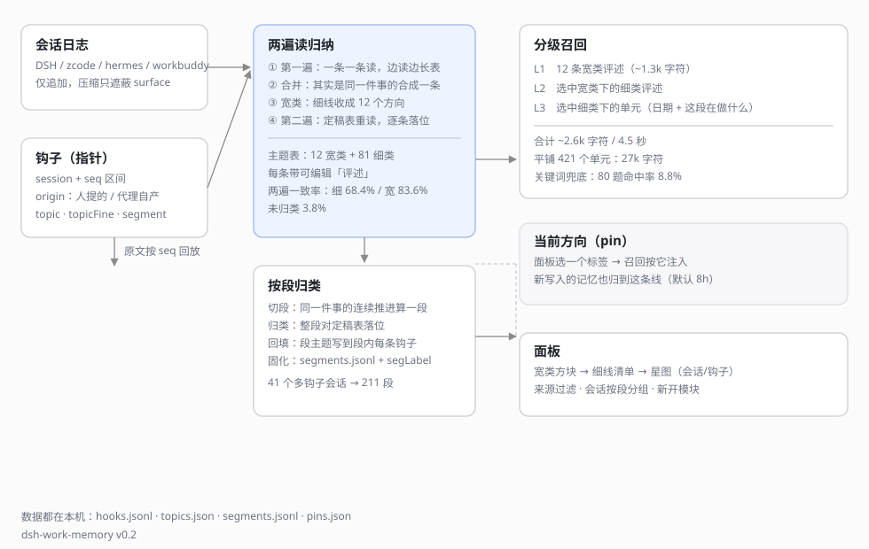

# dsh-work-memory

[English](README.en.md) ｜ 中文

跨对话的长期工作记忆。记住「你在哪个会话里提过什么需求、当时产出了什么文件、做法是什么」，需要时按 `session/seq` 把那段原文原样取回——包括被上下文压缩遮蔽的部分。

v0.2 起，它同时是一套**工作主题体系**：把历史材料读成 12 个宽类、81 条细线，每条带可编辑的评述；新对话按「段」归类，召回按「标签 → 子标签 → 单元」逐级往下走。



## 它现在做什么

| 层 | 做什么 | 数据 |
|---|---|---|
| 捕获 | 每轮把用户提问 + 写入的产物落成一条**指针**（不存正文） | `hooks.jsonl` |
| 来源 | 区分人提的需求与代理自产（子代理任务书、cron 投样板、workflow 子会话） | `origin` 字段 |
| 主题 | 两遍读归纳出的两层标签：宽类 `g01…g12` + 细类 `i01…i81`，每条带评述 | `topics.json` |
| 切段 | 把一段连续工作切成一个单元（同一段里的多条提问共享上下文） | `segments.jsonl` |
| 召回 | 分级判断，或按面板上选定的「当前方向」注入；关键词只做兜底 | `systemPrompt.context` |
| 维护 | 每小时重建 + 补归类 + 补切段 + 清备份 | 计划任务 |

## 为什么是「两遍读」

早先的做法是手工定 16 个主题、逐条分类。跑下来有两个毛病：分类器（关键词）和标注器（模型）只有 52% 一致；总有一个主题变成垃圾筐。

v0.2 换成归纳编码：

1. **第一遍**：按时间正序，一条一条读，能归入已有主题就归，归不进才新开。读完材料，主题表就定了。
2. **合并**：问模型「哪几对其实是同一个」，合并重编号。本轮 585 条材料长出 83 个细主题，只合掉 2 个——说明它们确实是不同的工作线。
3. **宽类**：把细线收成 12 个宽类，作为上层导航。
4. **第二遍**：拿定稿表重读全部材料，逐条落位（不许新开，归不进记 `NONE`）。

一致性：两遍在细类级一致 68.4%、宽类级 83.6%；第二遍的「归不进」占 3.8%。

## 为什么按「段」归类

会话是连续问答，单条看会误判——「继续吧」「那就这样」离开上下文没有意义。

实测：250 个人类会话里只有 41 个有 ≥2 条钩子，却覆盖了 376/585 条材料（64%）；其中 36 个会话的钩子散在多个细类里。按段归类后，长会话收拢回自己的线（命理 +21、DSH −23 条）。

## 召回

| 方式 | 做法 | 现状 |
|---|---|---|
| 分级（推荐） | 先跟 12 条宽类评述比 → 再进子标签 → 再进单元 | 原型验证：6 题 4 准，平均 2.6k 字符 / 4.5s |
| 方向注入 | 面板选定「当前方向」后，按那一类注入最近 5 条 | 已接入生产 |
| 关键词兜底 | 字面重合打分 + 阈值 | 已接入，但 80 题抽样命中率仅 8.8% |

分级召回还没接进生产路径（`cli/recall-hier.mjs` 是原型，`lib/units.js` 是生产与对账共用的注入单元实现）。

## 数据文件

```
<DSH_HOME>/work-memory/
  hooks.jsonl       账本（append-only）：指针 + 主题 + 来源 + 段
  topics.json       两层主题表：topics(宽类) + fine(细类) + 每条 annotation(评述，可手改)
  segments.jsonl    段表：一段连续工作的 id / 标签 / seq 跨度 / 段落主题
  pins.json         当前工作方向（面板上选定的标签，默认 8 小时过期）
  autopilot.log     计划任务日志
  .induct/          归纳与归类的中间状态（可断点续跑）
```

## 初次使用

```bash
# 1. 把本机历史对话变成账本
node cli/bootstrap.js --dry-run      # 预演
node cli/bootstrap.js --all          # 全跑（需要模型 key）

# 2. 读成主题表（一条一次调用，可断点续跑）
node cli/induct-topics.mjs --pass 1
node cli/induct-topics.mjs --merge
node cli/induct-topics.mjs --group
node cli/apply-induction.mjs         # 写 topics.json + 回写账本（带备份）

# 3. 归类（对定稿表，逐条）
node cli/induct-topics.mjs --assign
node cli/induct-topics.mjs --assign-apply

# 4. 按会话切段并归类
node cli/segment-sessions.mjs --build
node cli/segment-sessions.mjs --classify
node cli/segment-sessions.mjs --apply
node cli/segment-sessions.mjs --emit   # 写 segments.jsonl + 给钩子打标

# 5. 给标签写评述（分级召回用，可手改）
node cli/annotate-topics.mjs
```

日常维护交给计划任务：`cli/autopilot.cmd` 每小时跑一次重建，再跑 `cli/maintain.js` 补归类 / 补切段 / 清备份。

## 工具

| 工具 | 作用 |
|---|---|
| `memory_search(query, limit?)` | 检索钩子：标题 + 当时的需求 + 产物路径 + 时间 |
| `memory_open(id, query?, maxChars?)` | 按 seq 回放原文 |
| `memory_write(title, ask?, artifacts?, supersedes?)` | 手动补一条，或标记取代关系 |
| `memory_map(topic/session/recent/limit/includeAgents)` | 按主题/会话浏览：先总览、再主题、再会话、最后 `memory_open` |

## 实测与已知问题

- 关键词召回命中率 8.8%（80 题分层抽样）；120 条干净样本里 85 条零命中。降阈值反而更差（A/B 盲评）。**关键词不是瓶颈的解**，分级召回是替代方向。
- 分级召回在 L2 判空时会「一级都过不去」，已加退回逻辑；L3 的候选集还没扩到兄弟细类，抖音那类相邻边界会落空。
- 归纳与归类都依赖模型（默认 GLM），需要有 key；`--dry-run` / `--limit` 可以控成本。
- 账本只存指针；原文永远在 DSH 的会话日志里，因此删会话日志会让旧钩子失效（`memory_open` 会报找不到）。

## 目录

```
lib/          宿主插件：捕获、召回、工具、存储（store/topics/origin/browse/units）
cli/          一次性任务与工具：bootstrap / induct / segment / annotate / maintain / 诊断
docs/         架构与细节（ARCHITECTURE.md / DETAIL.md）
locale/       中英文案
```

## 许可

MIT
